# Diagramas do Piloto: Descoberta, Inferência IA e Alarmes (Ansible → SGTI CMDB)

**Data:** 26/10/2026
**Escopo:** operação de descoberta do piloto — Ansible Automation Platform (AAP) executando playbooks contra **vCenter ×3**, **Red Hat Satellite** e **OpenShift** — mais a **inferência por IA** (`infer_infra_map_ia.py`) e a **triagem de alarmes do Zabbix com IA** (RAG + contexto CMDB), todos povoados/via API com gravação idempotente.

Todo o tráfego usa **`X-Service-Token`** (conta de automação, hash bcrypt) e cada gravação gera **audit log** (CREATE/UPDATE, antes/depois, correlation ID).

---

## 1. Panorama geral — "Estação Central"

Três linhas de descoberta que convergem na mesma plataforma. O AAP é a estação central: cada fonte tem seu próprio playbook, todos desembarcam nos mesmos endpoints idempotentes da API.

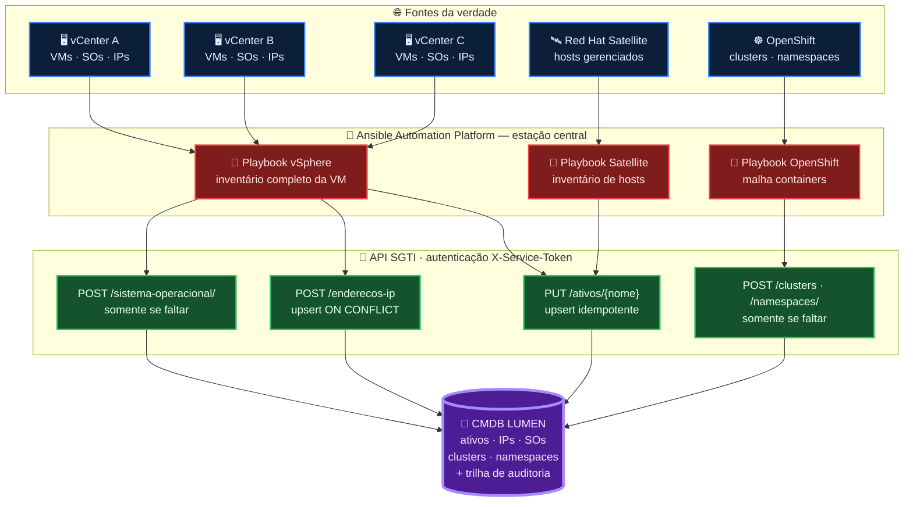

> 🎨 **Leitura:** três "linhas ferroviárias" (vSphere, Satellite, OpenShift) partem das fontes, se encontram na estação AAP e entregam passageiros (dados) em guichês padronizados (endpoints). Ninguém entra no pátio (CMDB) sem passagem válida e registro bilheteira (auditoria).

---

## 2. Playbook vSphere ×3 — "Da lâmina ao inventário"

Uma única execução varre os três vCenters e encadeia três camadas idempotentes: sistema operacional → máquina virtual → IPs.

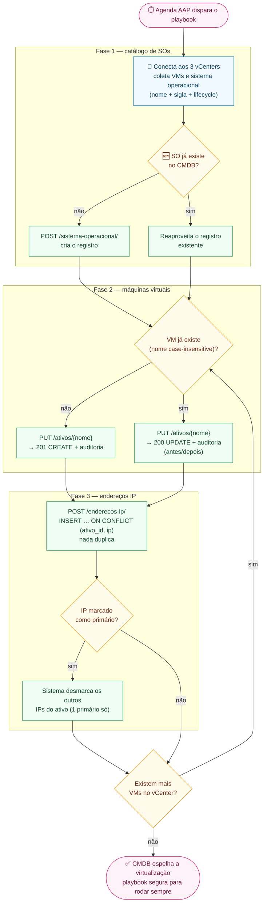

> 🛡️ **Garantia:** rodar o playbook duas vezes seguidas não muda nada de substantivo nem cria órfãos — é o princípio da **idempotência** que sustenta agendamento de alta frequência.

---

## 3. Playbook Satellite — "Host com seguro anti-duplicidade"

Coleta todos os hosts gerenciados e os acrescenta sem risco de cópia duplicada (a defesa fica no nome case-insensitive do ativo).

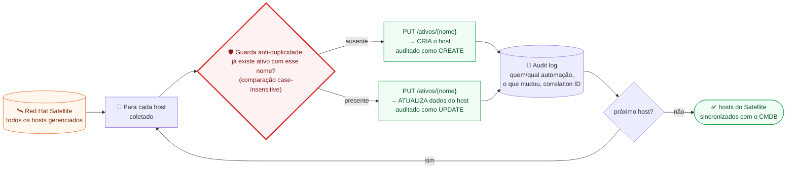

> 🎨 **Leitura:** a guarda anti-duplicidade é um "detector de metais" na porta de entrada: só passa o host inédito; o conhecido é apenas polido (atualizado) — nunca reproduzido.

---

## 4. Playbook OpenShift — "Do cluster ao namespace"

Captura a malha de containers em duas altitudes: o cluster (física/lógica agrupadora) e os namespaces dentro dele.

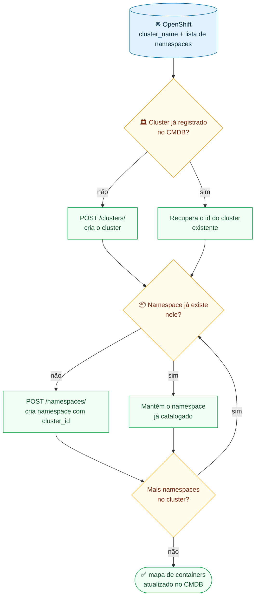

> 🎨 **Leitura:** o cluster é o "prédio" — criado uma única vez; os namespaces são os "apartamentos" catalogados um a um, sempre amarrados ao prédio via `cluster_id`. Relançar o playbook não constrói prédio nem apartamento duplicado.

---

## 5. Sequência no backend — por que nunca duplica

Detalhe técnico do contrato idempotente entre AAP, API e PostgreSQL (o "trilho" que os playbooks usam).

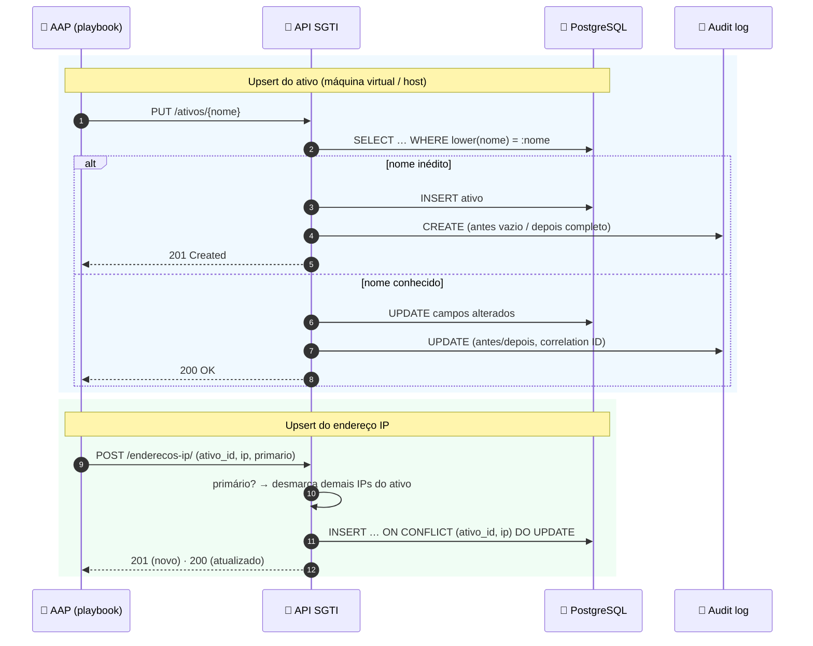

> 🧩 **Resumo do contrato:** a mesma chamada repetida N vezes produz **no máximo 1 criação** (201 na primeira) e só gera UPDATE quando algo de fato muda — sempre com trilha de auditoria.

---

## 6. O que cada fonte deixa no CMDB

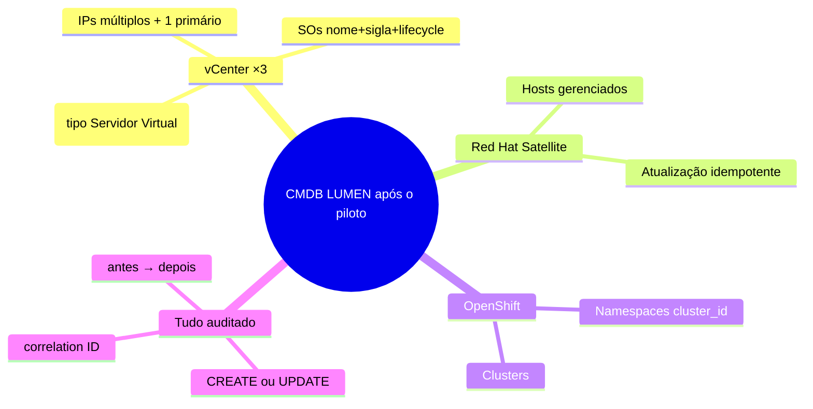

---

## 7. Contrato por fonte (referência rápida)

| Fonte | O que coleta | Endpoint SGTI | Comportamento idempotente |
|---|---|---|---|
| **vCenter ×3** | SO (nome, sigla, lifecycle) | `POST /sistema-operacional/` | cria apenas quando não existe |
| **vCenter ×3** | Machine virtual | `PUT /ativos/{nome}` | upsert por nome (case-insensitive): 201 CREATE · 200 UPDATE |
| **vCenter ×3** | Endereços IP | `POST /enderecos-ip/` | `ON CONFLICT (ativo_id, ip)` no PostgreSQL; flag primário única |
| **Red Hat Satellite** | Hosts | `PUT /ativos/{nome}` | guarda anti-duplicidade por nome case-insensitive |
| **OpenShift** | Cluster | `POST /clusters/` | consulta antes de criar |
| **OpenShift** | Namespaces | `POST /namespaces/` | consulta antes de criar; sempre ligado ao `cluster_id` |

Autenticação de todas as chamadas: header **`X-Service-Token`**. Toda mutação: **audit log** distinguindo CREATE de UPDATE.

---

# Parte 2 — Descoberta assistida por IA e triagem de alarmes

## 8. Pipelines de inferência — "Estúdio de fotografia de TI"

O script `infer_infra_map_ia.py` funciona como um estúdio fotográfico do mapa de TI: em quatro poses, o LLM local (llama3.2 + nomic-embed-text) retrata serviços, encaixa aplicações, batiza negócios e lê dependências — **cada foto sai com o selo de confiança**. O script lexical (`infer_infra_map.py`, dicionário regex) é o modo "retrato determinístico" — disponível via `--sem-ia` como baseline.

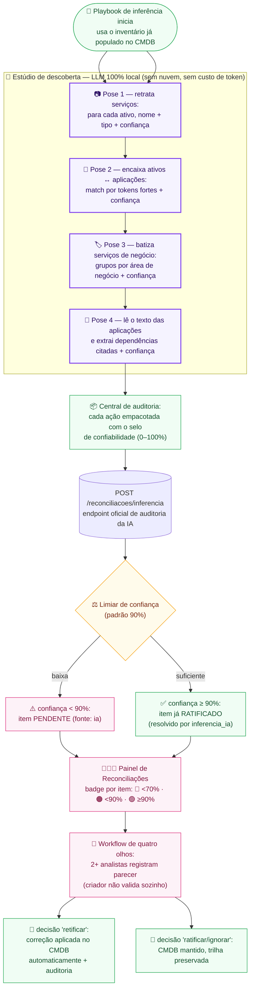

> 🎨 **Leitura:** o estúdio nunca entrega o álbum sem carimbo de qualidade. Fotos bem-sucedidas (≥ 90%) vão direto para o arquivo oficial (já ratificado, com trilha); as duvidosas voltam para a bancada dos especialistas (four-eyes) — **a IA propõe, os humanos confirmam**.

---

## 9. Sequência do portão de confiabilidade — calibração em ação

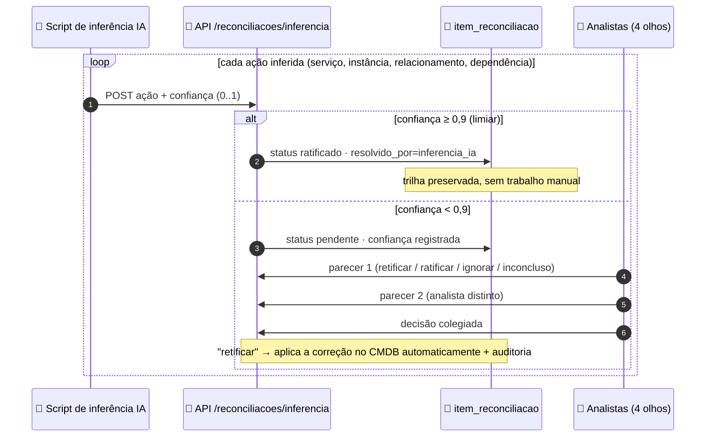

> 🧩 **Resumo:** o portão é o mesmo para human e máquina — baixa confiança vira **tarefa humana com guarda de dois pares**; alta confiança entra com trilha auditável. Nenhuma das vias grava sem passar pelo endpoint.

---

## 10. Triagem de alarmes com IA — "O analista júnior que nunca dorme"

Cada alarme do Zabbix pode ser analisado pela IA **dentro da rede**: a API monta o contexto do host no CMDB, busca procedimentos na base de conhecimento (RAG) e devolve uma análise em **4 seções** (diagnóstico → impacto → ação recomendada → escalonamento), citando os documentos usados.

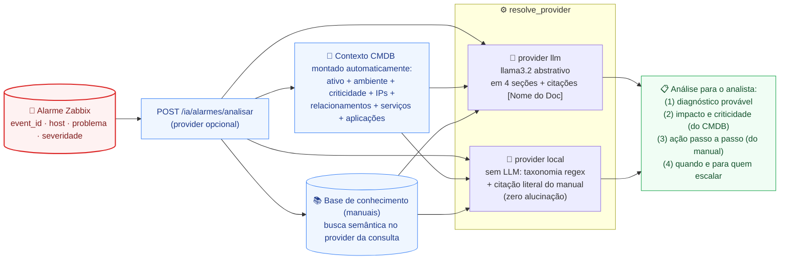

> 🎨 **Leitura:** dois motores para o mesmo propósito — o LLM redige com fluência quando há servidor liberado; a engine local (determinística) funciona sem LLM algum e **cita o manual ao pé da letra**. O impacto vem **sempre do CMDB**: um alarme em host "Baixa" é tratado de forma diferente de um em host "Crítica" com 5 aplicações hospedadas.

### Variante: a observação vira registro no próprio alarme

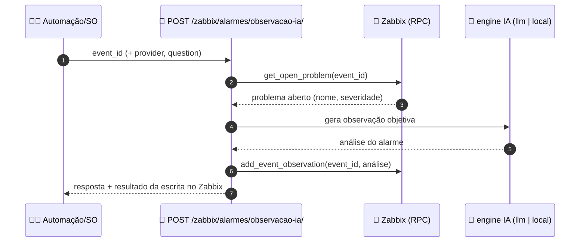

> 💡 A IA não só responde: **escreve a análise dentro do alarme no Zabbix** — o analista que abrir o evento encontra a triagem já documentada.

---

## 11. A esteira completa — "Do bip ao mapa corrigido"

Ciclo fechado que liga alarme, IA, reconciliação e a melhoria contínua do próprio mapa:

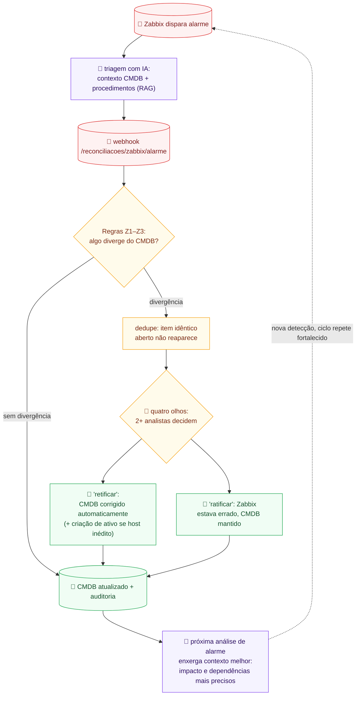

> 💡 **Resumo executivo:** quanto mais alarmes passam pela esteira, **mais preciso fica o mapa** que a IA usa para triar o próximo alarme — o sistema melhora operando, sem intervenção manual além da decisão especializada.

---

## 12. Contrato das rotas de IA (referência rápida)

| Fonte / consumidor | Operação | Endpoint SGTI | Comportamento |
|---|---|---|---|
| **Script de inferência IA** | reporta ações executadas | `POST /reconciliacoes/inferencia` | fonte `ia`: < limiar → `pendente` (4 olhos) · ≥ limiar → `ratificado` (por `inferencia_ia`) |
| **Zabbix** | webhook de alarme | `POST /reconciliacoes/zabbix/alarme` | regras Z1–Z3 · dedupe de itens abertos · acúmulo em uma execução fonte `zabbix` |
| **Analista/NOC** | triagem de alarme | `POST /ia/alarmes/analisar` | contexto CMDB + RAG · provider `llm` (abstrativo) ou `local` (taxonomia + citação literal) · análise em 4 seções |
| **Automação** | observação no alarme | `POST /zabbix/alarmes/observacao-ia/` | busca o problema na RPC do Zabbix, gera observação e registra no próprio evento |
| **Qualquer um** | pergunta aos manuais | `POST /ia/knowledge/perguntar[/stream]` | RAG com citações; provider por request (`llm` ↔ `local`) |
| **Qualquer um** | indexar/base | `POST /ia/knowledge/indexar` | grava assinatura do provider (`embed_provider`) — bases de providers distintos coexistem |

> ⚖️ **Onde a IA pode e onde não pode:** a IA pode **triar, inferir e propor**; só grava "já ratificado" quando a própria confiança calibrada libera (≥ 90%). Correções de baixa confiança e divergências Z1–Z3 **sempre** passam pelo workflow de quatro olhos — imposto pelo backend, não pela boa vontade.

---

# Parte 3 — Governança da máquina

## 13. Ciclo de vida do item de reconciliação — máquina de estados do four-eyes

O workflow inteiro vive no backend (`reconciliacoes.py`): qualquer tentativa de atalho responde **403/409** antes de tocar no banco. O diagrama embaixo é a máquina de estados real de `item_reconciliacao`:

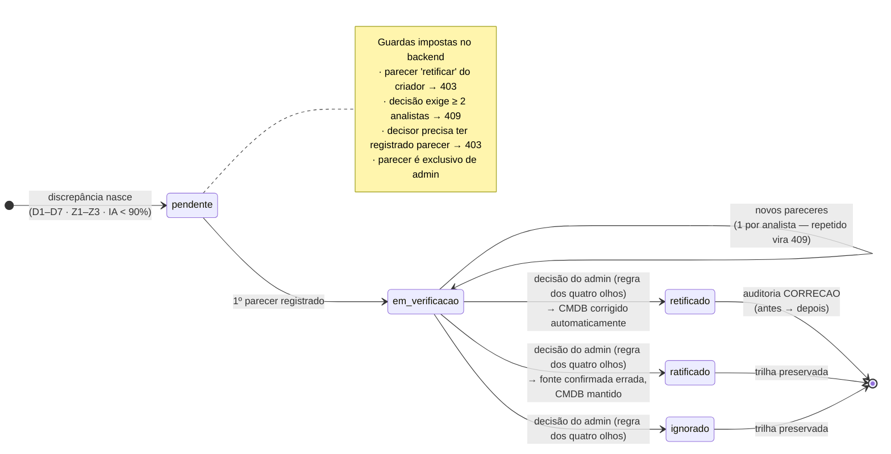

> 🎨 **Leitura:** o item só sai do trilho pendente/verificação por uma das três portas finais — e todas exigem a mesma chave: **duas pessoas**. Nem o criador da execução consegue abrir a porta "retificado" sozinho.

## 14. Correção automática — o que a decisão "retificar" aplica no CMDB

Cada tipo de discrepância tem sua regra de reparo (`aplicar_correcao_cmdb`). Onde a regra não garante integridade, o sistema **recusa conscientemente** e registra a nota — nada é aplicado às cegas:

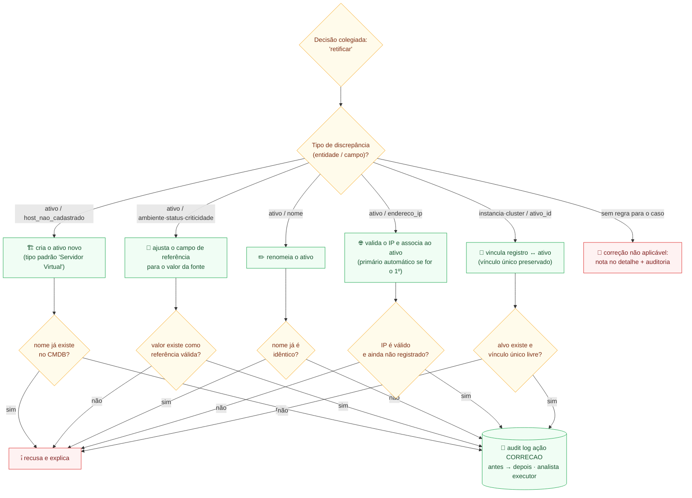

> 🛡️ **Filosofia:** automação corajosa em aplicar, **humilde em recusar** — cada recusa é explicada no próprio item e auditada. O analista nunca fica sem saber por que a correção não foi aplicada.

## 15. Segurança — do login ao crypto-lock

Autenticação (AD/LDAP com fallback, 2FA TOTP opcional, JWT) e a trava de boot do sistema:

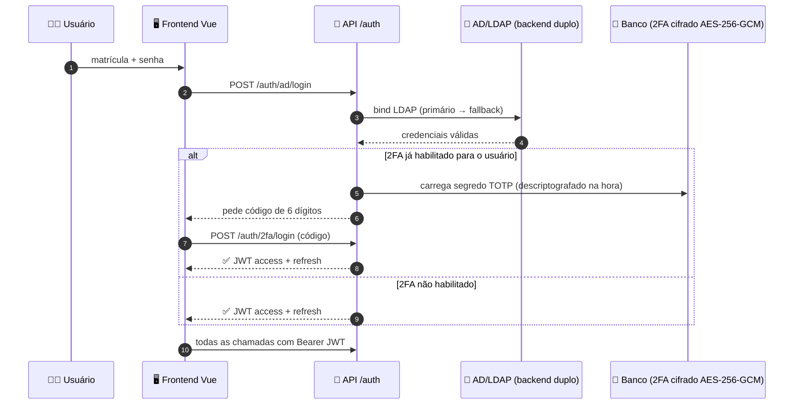

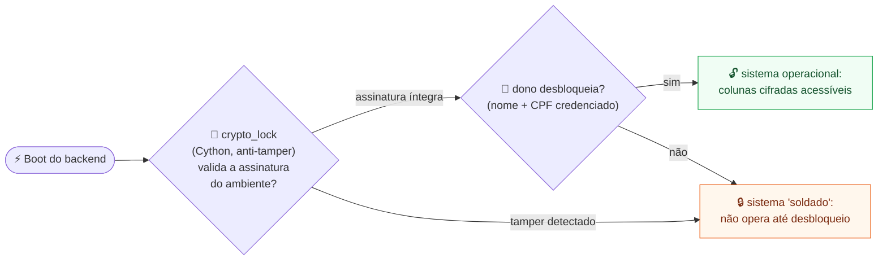

> 🎨 **Leitura:** a senha abre a porta de entrada; o crypto-lock é o **cofre do prédio** — mesmo com a porta aberta, nada circula sem a chave do dono validada por módulo compilado (`.so` Cython) resistente à violação.

## 16. O esqueleto do CMDB — modelo de dados essencial

O "desenho elétrico" do banco que sustenta todos os fluxos acima (relações-chave, simplificado):

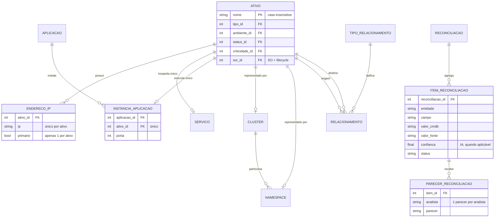

> 🧩 **Três invariantes visíveis de cara:** a) nome do ativo é a chave de upsert das automações; b) os vínculos "hospeda/executa/representa" são **único** — a IA e as correções respeitam; c) cada parecer é pessoal e intransferível — é isso que torna o four-eyes matemático.